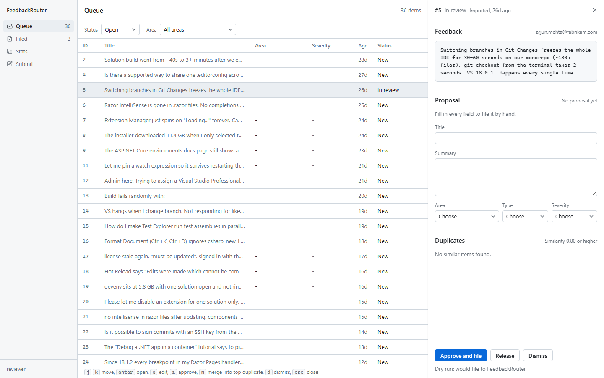
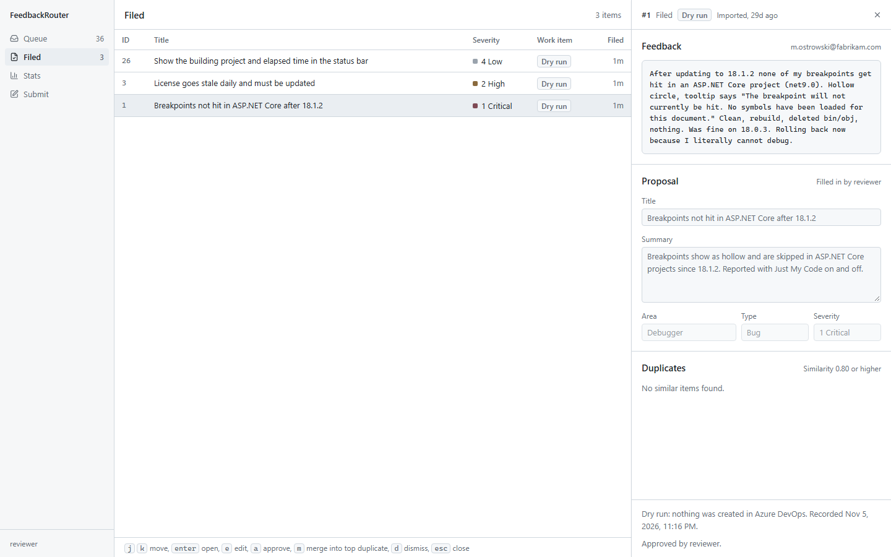
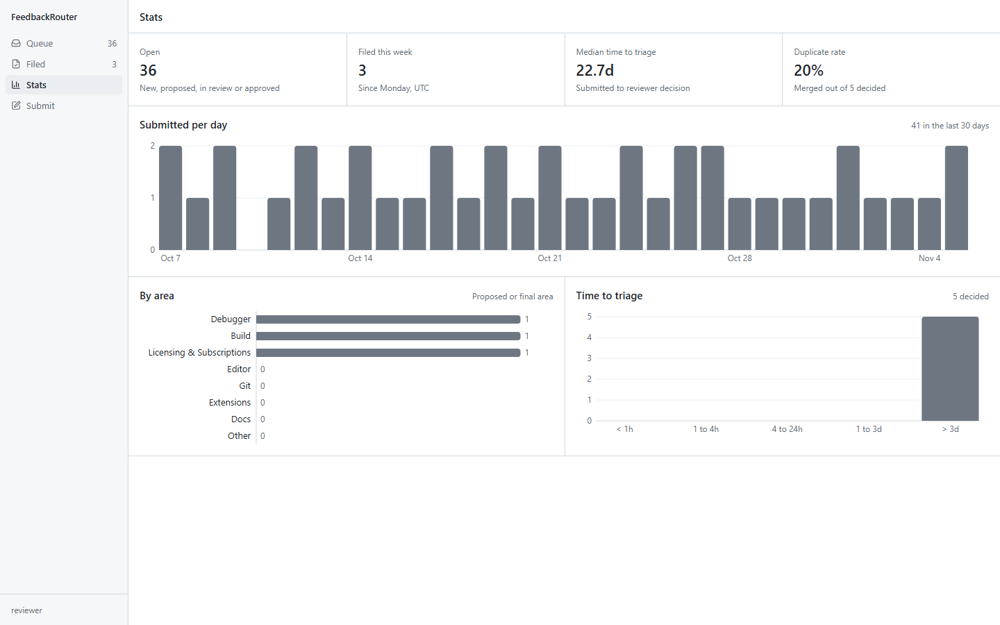
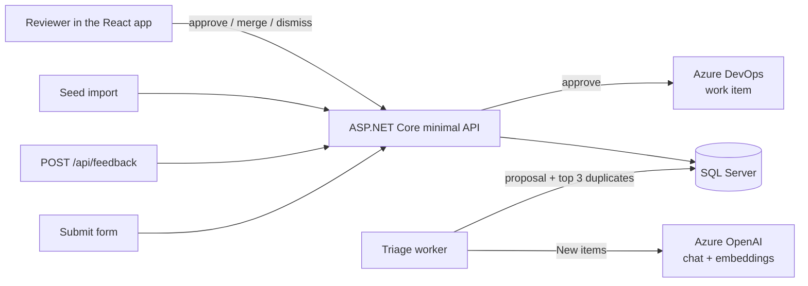

# FeedbackRouter

FeedbackRouter is a small version of the Visual Studio Developer Community loop: people submit feedback, and an LLM proposes an area, type, severity, title, summary and likely duplicates. A human reviewer edits the proposal and approves, merges or dismisses it; nothing is filed without a person deciding. Approving files an Azure DevOps work item, and a stats page shows volume, areas and time to triage.



| Filed | Stats |
| --- | --- |
|  |  |

## How it works



1. Feedback arrives as **New**.
2. The triage worker embeds the text and compares it with earlier items (cosine similarity, threshold 0.80, top 3). It asks the model for strict JSON, validates it and retries once. A valid answer makes the item **Proposed**; a second invalid answer leaves it New with the error shown. Prompt: `src/FeedbackRouter.Core/Prompts/triage.v1.md`.
3. A reviewer can click **Start review** to claim an item (**In review**). The claim ends on release, on a decision, or after 30 minutes idle. The item then goes back to Proposed or New.
4. **Approve and file** creates the work item in Azure DevOps (REST 7.1, JSON Patch). The item becomes **Filed** only when Azure DevOps confirms. If filing fails, the item stays **Approved**, the error shows in the pane, and approving again retries. Two approves at the same time file once.
5. **Merge** points the item at the original; **Dismiss** closes it.

With `AzureDevOps:DryRun` on (the default), approve records the decision without calling Azure DevOps, and the item shows a **Dry run** badge. Without LLM settings, triage is off and the reviewer fills in every field by hand.

## Run it locally

Requirements: Docker Desktop. For development without Docker for the app: .NET 10 SDK and Node 24.

### Everything in Docker

```sh
docker compose up --build
curl -X POST http://localhost:5080/api/seed   # 40 sample items, Development only
```

Open http://localhost:5080. The API serves the built frontend. SQL Server runs in a container with a named volume, so data survives restarts (`docker compose down -v` wipes it).

### Frontend and API with hot reload

```sh
docker compose up -d sql                 # SQL Server only
dotnet run --project src/FeedbackRouter.Api   # http://localhost:5080, applies migrations
cd src/FeedbackRouter.Web
npm ci
npm run dev                              # http://localhost:5173, proxies /api to :5080
```

### Tests and checks

```sh
dotnet test                              # xUnit, SQLite for endpoint tests
dotnet format --verify-no-changes
cd src/FeedbackRouter.Web && npm run lint && npm run build
```

## Configuration

Set these as environment variables (double underscore for nesting) or in a `.env` file next to `docker-compose.yml`. Never commit secrets.

| Setting | Default | Purpose |
| --- | --- | --- |
| `ConnectionStrings__FeedbackRouter` | local SQL Server | Database |
| `Llm__Provider` | `AzureOpenAI` | `AzureOpenAI` or `OpenAI` |
| `Llm__Endpoint`, `Llm__ApiKey` | empty | Triage runs only when both are set (OpenAI needs only the key) |
| `Llm__ChatModel`, `Llm__EmbeddingModel` | `gpt-4o-mini`, `text-embedding-3-small` | Deployment or model names |
| `AzureDevOps__Organization`, `AzureDevOps__Project` | empty | Where work items go |
| `AzureDevOps__Pat` | empty | PAT with Work Items read and write |
| `AzureDevOps__DryRun` | `true` | Log the work item instead of creating it. Always on when no PAT is set |
| `Database__Provider` | `SqlServer` | `SqlServer` or `Postgres` |
| `Demo__Enabled` | `false` | Public demo: seeds an empty database, resets it nightly, shows a banner, never files |
| `Auth__RequireSignIn` | `true` (`false` in Development) | Require a signed-in reviewer, see below |
| `Reviewer__Name` | `reviewer` | Name recorded on decisions when sign-in is off |
| `RateLimit__SubmitPerMinute` | `10` | Submissions per IP per minute |
| `APPLICATIONINSIGHTS_CONNECTION_STRING` | empty | Send OpenTelemetry to Azure Monitor; otherwise traces go to the console |

**Sign-in.** With `Auth__RequireSignIn=true`, reviewer endpoints return 401 unless the request carries `X-MS-CLIENT-PRINCIPAL-NAME`. Azure Container Apps built-in sign-in sets that header and strips it from client requests. Turn this on only behind that sign-in; anywhere else the header could be forged. Submitting feedback never needs sign-in.

## Using the queue

| Key | Action |
| --- | --- |
| `j` / `k` | Move down / up |
| `enter` | Open the selected item |
| `e` | Edit the title |
| `a` | Approve and file |
| `m` | Merge into the top duplicate |
| `d` | Dismiss |
| `esc` | Close the pane, or leave a field |

## API

| Method | Path | |
| --- | --- | --- |
| POST | `/api/feedback` | Submit `{ text, email? }`, rate limited, public |
| GET | `/api/queue?status=&area=` | Items, most severe first |
| GET | `/api/feedback/{id}` | Detail with proposal, duplicates, decision and work item |
| POST / DELETE | `/api/feedback/{id}/review` | Start or release a review |
| POST | `/api/feedback/{id}/decision` | `{ action: Approve \| Merge \| Dismiss, ...edits, mergeIntoId? }` |
| GET | `/api/stats` | Counts, per-day volume, time to triage |
| GET | `/api/me` | Current reviewer |
| POST | `/api/seed` | Import `seed/feedback.json`, Development only |
| GET | `/healthz` | Database health |

## Layout

```
src/FeedbackRouter.Core    domain, triage pipeline, prompt, duplicate detection (no framework references)
src/FeedbackRouter.Infra   EF Core, Azure DevOps client, LLM adapters
src/FeedbackRouter.Api     minimal API endpoints, decision and review services, background workers
src/FeedbackRouter.Web     React 19 + Vite frontend
tests/FeedbackRouter.Tests xUnit tests
seed/feedback.json         40 sample items
```

## Next steps

- Turn triage on with an Azure OpenAI deployment and check proposal quality against the seed set.
- Before retrying a failed filing, query Azure DevOps for the `feedback:{id}` tag, so a lost response cannot create a second work item.
- CI in GitHub Actions: build, test, format and lint on pull requests.
